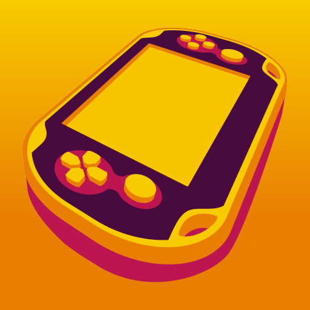
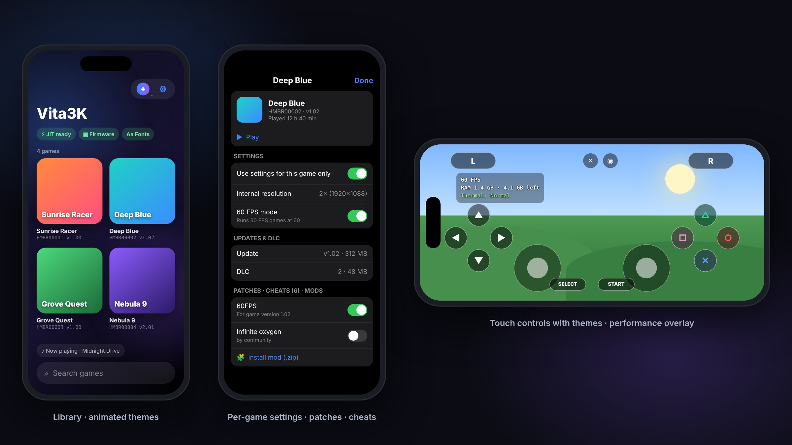

<p align="center">
  
</p>

<h1 align="center">Vita3KiOS</h1>

<p align="center">
  <b>A PlayStation Vita emulator for iPhone and iPad, built on <a href="https://github.com/Vita3K/Vita3K">Vita3K</a>.</b><br>
  The full Vita3K core in a native iOS app, with JIT on iOS 26.
</p>

<p align="center">
  <a href="../../releases/latest"></a>
  <a href="../../actions/workflows/ios.yml"></a>
  
  
  <a href="https://discord.gg/pZyQDPHKF"></a>
  <a href="https://ko-fi.com/Oledz"></a>
</p>

<p align="center">
  
  <br><sub><i>Interface preview. The games shown are placeholders, not real titles.</i></sub>
</p>

---

## Highlights

|  |  |
|---|---|
| 🎮 **Full Vita3K core** | The same CPU recompiler, GXM → Vulkan renderer (via MoltenVK) and HLE as desktop Vita3K, kept in sync with upstream. |
| ⚡ **JIT on iOS 26** | Through StikDebug's `universal.js` (from Tsubomi). JIT memory is set up in one batched step, so launch takes about two seconds. |
| 📦 **Installs everything** | `.pkg`, `.vpk`, `.zip` and dumped folders, including **updates and DLC**. A zip full of `.pkg`s installs in the right order: game → update → DLC. Updates don't ask for a zRIF. |
| 🛠 **Per-game everything** | Settings, community **patches**, **cheats** (VitaCheat database built in), **mods** (rePatch layout), updates & DLC, and save backups, all from one sheet. |
| 🚀 **Performance options** | 60 FPS mode, Fast CPU, upscaling up to 4×, background shader compilation and a shader cache kept between sessions. |
| 📊 **Performance overlay** | Pick what to show: FPS, frame time, CPU, memory, thermals, battery, resolution. Place it where you like. |
| 🎨 **Looks the part** | Eight animated themes that respond to tilt, original menu music made on the device, and touch-control themes (PlayStation, Xbox-style letters, Nintendo-style, Neon, Minimal). |
| 🕹 **Controls your way** | Play in landscape or upright (portrait mode puts the game on top and the controls below). Drag and pinch the touch controls into your own layout, use the rear touchpad, and tilt the iPhone for motion games. Any MFi, Xbox, PlayStation or Switch controller works too, with remapping and a ✕/○ swap. |
| 📸 **Game menu** | Screenshots straight to Photos, rear touchpad, layout editor, show/hide controls, quit. Open it with ✕ on screen, Home/PS on a controller, or by holding Select + Start. |
| 📱 **Feels native** | Put any game on your Home Screen (`vita3k://launch/<TITLE ID>` links), long-press the app icon for recent games, and use "Open in Vita3K" from Files or Safari. |
| 💾 **External storage** | Keep games on a USB-C SSD, thumb drive or SD reader. |
| 🩺 **Crash reports** | If a game crashes, the next launch shows what happened. **Report a problem** in Settings bundles the logs, crash report, device and settings into one file for the Discord. |
| ✅ **Knows your games** | Each game shows its state on the Vita3K compatibility list, and games with known issues get recommended settings automatically from an online fixes list ([`dist/game-fixes.txt`](dist/game-fixes.txt)) that can be updated without a new release. |

## Requirements

- iPhone or iPad with an **A12 chip or newer**, on **iOS 17.4 or later**
- A way to sideload an unsigned `.ipa`: AltStore, SideStore, LiveContainer or TrollStore
- [StikDebug](https://github.com/StephenDev0/StikDebug) for JIT
- Your own PS Vita firmware and game dumps

## Install

**AltStore / SideStore** (in-app updates). Add this source:

```
https://raw.githubusercontent.com/oledz-i/Vita3KiOS/main/dist/altstore/source.json
```

**LiveContainer, TrollStore or another signer.** Download `Vita3KiOS-<version>.ipa` from [Releases](../../releases/latest).

**Test builds.** Every commit is built: open the newest successful run of the [iOS workflow](../../actions/workflows/ios.yml) → **Artifacts** (you need to be signed in to GitHub).

New versions install over old ones and keep your games and saves.

## Enabling JIT

Vita3K translates game code while it runs, so it needs JIT. Without JIT, games won't start, and the app tells you so.

**iOS 26 on A15/M2 or newer (iPhone 13 and later).** You need StikDebug's `universal.js` script:

- **LiveContainer:** long-press Vita3K → Settings → turn on **Launch with JIT** and set **JIT Launch Script** to `universal.js`. In LiveContainer's settings, choose StikDebug as the JIT enabler.
- **Installed directly:** in StikDebug, assign `universal.js` to Vita3K and enable JIT.

The status pill turns green (**JIT ready**) once Vita3K has set up its JIT memory.

**iOS 17.4–18, or older chips.** Enabling JIT in StikDebug, or LiveContainer's "Launch with JIT", is enough.

## Getting started

1. **Firmware.** Download the Vita firmware (`PSVUPDAT.PUP`) and fonts (`PSP2UPDAT.PUP`) from PlayStation's site. Tap **+** → **Files** and pick them.
2. **Games.** Use the same **+** button for `.vpk`, `.pkg`, `.zip` or a dumped game folder. You can also share a file to Vita3K (**Open in Vita3K** in Files or Safari), or drop files into **Files → On My iPhone → Vita3K → Import**.
3. **Updates & DLC.** Install the game first, then its update and DLC `.pkg`s, one at a time or together in a zip or folder. Vita3K sorts them so the game always goes in first.

**zRIF licences.** Game and DLC `.pkg`s need their zRIF. Vita3K asks for it, or you can put a `.zrif` text file with the same name next to the `.pkg`. Updates use the base game's licence and don't ask.

Long-press a game for its settings, patches, cheats, mods, updates & DLC, and save backups. **Add to Home Screen…** in the same sheet copies a launch link and walks you through making a Home Screen icon with Shortcuts.

### Patches, cheats and mods

- **Patches** come from the community [vita3k-patches](https://github.com/Vita3K/vita3k-patches) list: 60 FPS, resolution and bug-fix patches. Download the list once (**Settings → Patches**, or from any game's sheet), then switch each patch on or off. Patches apply the next time the game starts. Each game shows only the patches that exist for it.
- **Cheats** use the VitaCheat `.psv` format. The community database is built in, and you can import your own.
- **Mods** use the rePatch layout (`ux0:rePatch/<TITLEID>`), so most Vita mods work unchanged. Install them from a `.zip` in the game's sheet.

### External storage

Go to **Settings → Storage → Choose folder or drive…** to keep games, saves and firmware on an external drive or any folder the Files app can reach. If you already have a desktop Vita3K folder (with `ux0` inside), copy it over and pick it. If the drive isn't connected at launch, Vita3K falls back to the device's storage and tells you.

## Performance tips

- **Start with the defaults.** Most games run best at native resolution with background shader compilation on.
- **60 FPS mode** and **60 FPS patches** double the frame rate of 30 FPS games when the patch list has one for your game. Use one or the other, not both.
- **Fast CPU** trades some floating-point accuracy for speed. It helps CPU-heavy games, but switch it off if a game misbehaves.
- **Upscaling** costs GPU time. Try 1.5× or 2× on Pro models, and keep an eye on the thermals line in the overlay.
- **Low Power Mode** and a hot iPhone slow games down a lot. The library tells you when either is the case.
- **First runs** stutter while shaders compile. The cache is saved, so the second session is smoother.

## Known issues

- Compatibility follows upstream Vita3K. Check the [compatibility list](https://vita3k.org/compatibility.html) first.
- Some games are affected by upstream Vulkan renderer bugs. For example, *Minecraft* v1.00 plays audio over a black screen.
- iOS can close the app under heavy memory pressure. Close other apps before demanding games.

Send `vita3k.log` (**Settings → About → Share log**) when you report a problem, on the [Discord](https://discord.gg/pZyQDPHKF) or in [Issues](../../issues).

## Building

CI builds every push on GitHub Actions ([`ios.yml`](.github/workflows/ios.yml)). CMake generates an Xcode project, `xcodebuild` builds it unsigned, and the app is packaged as an IPA. Repeat builds take about 6 minutes, because vcpkg packages, CMake checks and compiled objects are cached.

To build locally on a Mac with Xcode 26 and a bootstrapped [vcpkg](https://github.com/microsoft/vcpkg):

```sh
git clone --recursive https://github.com/oledz-i/Vita3KiOS
cd Vita3KiOS
VCPKG_ROOT=/path/to/vcpkg bash .ci/build-ios.sh artifacts
```

**Releasing.** Actions → iOS → *Run workflow* with a version number, or push a `v1.2.3` tag. The IPA is attached to a GitHub Release and the AltStore / SideStore source is updated automatically.

The iOS code lives in `vita3k/ios/`: the app target, SwiftUI frontend, C bridge to the core, and JIT. The dynarmic JIT patch is in `vita3k/ios/patches/` and is applied at configure time.

## Support

**Need help or found a bug?** Join the **[Discord](https://discord.gg/pZyQDPHKF)**. When reporting a problem, say which game and where it broke, and attach the crash report and `vita3k.log` (**Settings → About → Share log**).

If Vita3KiOS is useful to you, you can buy me a coffee on **[Ko-fi](https://ko-fi.com/Oledz)**. Thank you!

<a href="https://ko-fi.com/Oledz"></a>

## Credits

- **[Vita3K](https://github.com/Vita3K/Vita3K)** and its contributors: the emulator this app is built on. Please support the upstream project.
- **[Tsubomi](https://github.com/125hz/Tsubomi)** by **125hz**: the iOS 26 JIT implementation and JIT region pool, guest memory pre-reservation, the iOS audio session setup and the high-density game window.
- **[MrBouza](https://github.com/MrBouza)**: fixed FSR on iOS (PR #1), added the on-screen keyboard for game text input (PR #2), and fixed the 16 MB JIT cache limit.
- **[Vita3K-Plus](https://github.com/nckstwrt/Vita3K-Plus)** by **nckstwrt**: many game compatibility fixes (graphics, audio, saves, timing) ported from this Vita3K fork. Also GPL.
- **[dynarmic](https://github.com/merryhime/dynarmic)** and **oaknut** by merryhime, **[MoltenVK](https://github.com/KhronosGroup/MoltenVK)**, **[SDL](https://github.com/libsdl-org/SDL)**, and the other libraries in `external/`.

## Legal

Vita3KiOS doesn't include any games, firmware or keys. Only use content you dumped from hardware you own. This project isn't affiliated with or endorsed by Sony Interactive Entertainment. "PlayStation" and "PS Vita" are trademarks of their respective owners.

Licensed under the GNU General Public License v2 or later, like Vita3K. See [COPYING.txt](COPYING.txt).
